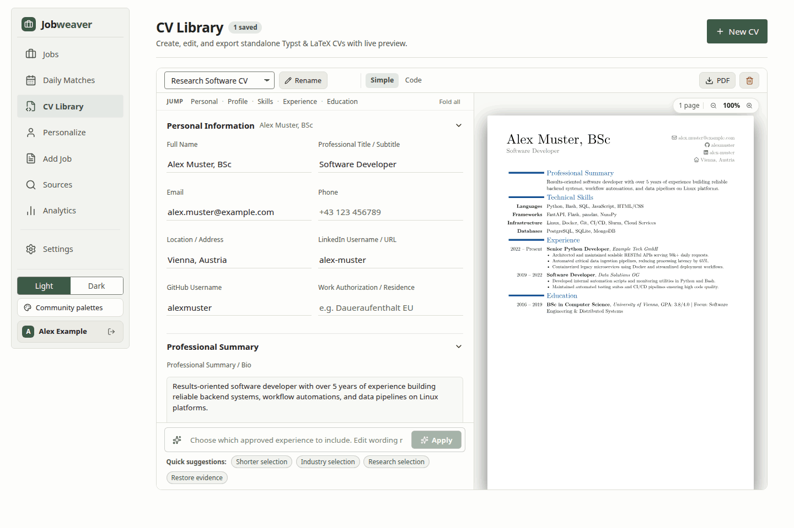

# Jobweaver

A self-hosted workspace for collecting job postings, checking how well they fit your background, and drafting applications from facts you can actually defend.


*The demo uses fictional postings and hand-prepared requirement checks and documents ([smooth 30fps MP4 clip](docs/media/hero.mp4)).*

Searching for a technical role usually means juggling browser tabs, a spreadsheet, and a folder of half-edited CV and cover-letter drafts. Worse, if you ask a language model to tailor an application from a raw CV, it tends to exaggerate. A script you adapted becomes a platform you "architected", and hard requirements you do not meet get smoothed over with generic buzzwords.

I built Jobweaver to keep the posting, fit check, application stage, and document history in one place, and to put strict guardrails around what the model is allowed to claim. You can pull in postings by pasting text, giving a URL, polling employer feeds, or running Apify connectors. Jobweaver checks each posting against your CV, tracks your applications through seven stages from `New` to `Offer` or `Rejected`, compiles PDFs with Typst or LaTeX while keeping earlier revisions, and exposes four read-only MCP tools if you want to query your pipeline from an assistant. Each account on the server has its own postings, profile, settings, and document library.

I built this for my own job search. It turned out to be so helpful that I decided to share it, in case it is useful to someone else too.

## Project status

Early release (October 2026). Jobweaver is meant to run on your own computer or home server for yourself and a few people you trust. It has per-account data, isolated document compilers, request limits, and daily model quotas, but it has not had an external security review and is not hardened for the open internet. Run it on localhost or a private network such as Tailscale or WireGuard, and read [Known limitations](#known-limitations) before relying on it.

The [Glossary](#glossary) defines the technical terms in this README.

<details>
<summary>Four views of the demo</summary>


</details>

## What makes it different

Instead of feeding a free-form CV straight into a prompt, you can maintain a structured career record that separates work you authored yourself, code you adapted from someone else, basic familiarity, and AI-built systems you specified and directed. The document pipeline uses those distinctions when it selects and phrases evidence. The CV renderer keeps your approved wording intact. When the letter writer drafts a cover letter, it has to cite specific claims from your record, and a separate verifier model checks the draft against those claims before you see it. That catches a lot of overreach, though it is still no substitute for reading the final letter yourself before sending it.

Fit ratings work the same way. Rather than asking a model to invent an opaque 0 to 100 score, Jobweaver asks it to judge each requirement in the posting as `shown`, `related`, or `missing` in your CV, backed by exact quotes from both texts. Fixed rules in Python, not the language model, then turn that checklist into a rating: `Great`, `Good`, `Decent`, `Stretch`, or `Poor`. Preference conflicts from your standing notes can lower that rating, and a firm conflict or eligibility blocker marks the job as `Blocked` (postings with no checkable requirements stay `Unrated` unless a blocker applies). Requirement checks are still model judgements rather than hiring probabilities, and whenever you update your CV or switch models, older analyses are marked as historical until you click **Re-rate** on a job.

The Jobs view groups postings by rating so the strongest matches stay at the top while `Poor` and `Blocked` roles start folded out of the way. Stage tabs, search, and a Filter panel narrow the list, and clicking any row opens its requirement quotes and document studio.

## Quick start

### Try the demo

You need these tools:

- Python 3.12
- [uv](https://docs.astral.sh/uv/)
- Node.js 22.12 or later
- npm
- Make

The demo does not need API keys, a browser scraper, or a local TeX or Typst installation.

```bash
git clone https://github.com/fyalcin/jobweaver.git
cd jobweaver
uv sync --frozen
npm --prefix webapp ci
make demo
```

Open [http://127.0.0.1:8001](http://127.0.0.1:8001) and click **Explore the demo**. You can also sign in with `demo` / `demo`.

The demo includes a fictional applicant (Alex Example), 15 fictional postings across all rating tiers, and three prepared pairs of CVs and cover letters. All requirement checks, letters, and evidence links in the demo are hand-prepared examples. No live model or automated verifier produced them.

In the demo, you can:

- Filter jobs.
- Read the evidence tables.
- Change the color palettes and fonts in Settings.
- Download the compiled PDFs.

The demo disables write actions, scraping, and model calls.

Press `Ctrl+C` to stop the demo. Each `make demo` run uses a new temporary directory. It never changes your real database or profiles. If port 8001 is busy, build the frontend once and select a different port:

```bash
uv run --frozen python scripts/demo.py --port 8002
```

### Use your own data

Run all `python -m jobweaver...` commands from the repository root. They do not work from other directories.

First, complete the dependency setup above. These commands then copy the example environment file, set an administrator password, build the frontend, and start the server:

```bash
cp .env.example .env
uv run python -m jobweaver.manage_users passwd admin
npm --prefix webapp run build
uv run python -m jobweaver.server
```

Open [http://127.0.0.1:8000](http://127.0.0.1:8000) and sign in as `admin`. Put your CV text in **Personalize**. Select your models and collection sources in **Settings**.

Scoring and document generation stay off until your account has its own CV, in Personalize or in a career record. This prevents accidental scoring against the fictional template. If an analysis fails, the Jobs tab shows the failure reason and a retry button.

To add another person to your instance, run `uv run python -m jobweaver.manage_users add USERNAME`.

To build documents from verified claims, do these steps:

1. Copy `examples/career_record.example.yaml` to `profiles/admin/career_record.yaml`.
2. Replace the fictional entries with your own history.
3. Check the file before you generate documents:

```bash
uv run python -m jobweaver.career_record check profiles/admin/career_record.yaml
```

The [career record format guide](docs/career-record/FORMAT.md) explains claims, ownership levels, and approved wording. A German CV or cover letter needs approved German wording on each claim that the document uses.

### Document tools

Typst is the default document engine. It can preview and export PDFs directly in the browser. LaTeX is also available. Typst users do not need a LaTeX installation.



The demo includes pre-compiled PDFs. On a real instance, server-side generation, validation, and finalization need these native command-line tools on Linux:

| Purpose | Installed tools |
|---|---|
| Native tool isolation | Linux with Bubblewrap (`bwrap`), `prlimit`, and enabled user namespaces |
| PDF validation and previews | Poppler (`pdfinfo`, `pdftoppm`, `pdftotext`) |
| Typst documents | Typst CLI 0.14 or later |
| LaTeX documents | `pdflatex` and packages used by the template, including Source Sans Pro |
| Legacy LaTeX comparison | `latexdiff` |

When you finalize an edited document, the server checks the saved source with a native build in a Bubblewrap sandbox. If a build fails, Jobweaver keeps the last good PDF.

Native builds do not run without sandbox isolation. There is no fallback without isolation. Native workers do not yet support server operating systems other than Linux. Keep your checkout and personal data outside system or compiler installation directories.

Each sandboxed build sees only its own document inputs and public template assets. It never sees server credentials or the profiles of other accounts. Jobweaver stops any build that writes more than 4 MiB of output or 256 KiB of diagnostics.

## Configuration

Credentials are in `.env` and personal files are in `profiles/`. Both stay outside Git.

| Setting | Use |
|---|---|
| `OPENROUTER_API_KEY` | Hosted models through OpenRouter |
| `CUSTOM_MODEL_BASE_URL` | OpenAI-compatible endpoint, including its `/v1` path |
| `CUSTOM_MODEL_API_KEY` | Endpoint credential, if required |
| `APIFY_API_TOKEN` | Optional Apify job connectors |
| `JOBWEAVER_DATA_DIR` | Separate directory for the SQLite database and `profiles/` |
| `JOBWEAVER_ALLOWED_HOSTS` | Additional exact server hostnames or IPs (loopback is allowed by default) |
| `JOBWEAVER_HTTPS_ONLY` | Set to `1` behind HTTPS to enable `Secure` cookies and refuse plain HTTP |

Configure at least one model route for scoring and letters. Models from a custom endpoint show as `custom/<model>` in Settings.

Scoring many job postings has a very different cost profile from drafting a cover letter. Scoring and document generation therefore use separate model selections.

Settings also shows the model that verifies cover letters. By default, this model uses your custom writer's endpoint or a hosted default. You can also select a verifier explicitly.

Company Notes & Research uses a separate hosted Perplexity Sonar call when you click **Fetch web notes** on a job.

The default palette is Loden Light, with a Light/Dark toggle in the sidebar. Settings also has seven community palettes (Kanagawa, Catppuccin, Rosé Pine, and Nord) and typography options. The default fonts are Fira Sans and Fira Mono. They load from Google Fonts and use local system fonts when offline. Each account saves its own appearance choices. The demo saves them in `localStorage`.

SQLite stores user sessions as hashes. Jobweaver revokes sessions on sign-out or password change. It also rate-limits sign-in attempts and returns HTTP 429 with a retry delay. When you delete an account, Jobweaver retires its username. A new user can never inherit the retained profile files.

To store your database and `profiles/` outside the repository, create that directory first. Then export `JOBWEAVER_DATA_DIR` before you run any command. Back up your data directory and `.env`.

### Job sources and daily collection

Built-in employer feeds support Greenhouse, Personio, SmartRecruiters, and SuccessFactors. To select employers, copy `examples/companies.example.json` to `profiles/<user>/companies.json`. Keep the employers that you want to poll. The example file lists real public employer feeds. The demo uses fictional postings.

If you have an Apify account, the LinkedIn and Karriere.at connectors map their results into the same internal posting schema. Every imported posting passes through the [Posting gate](docs/adr/0006-one-posting-schema-with-a-gate.md).

URL imports read `schema.org/JobPosting` data over pinned public IPs. They have strict byte, redirect, and timeout caps. [ARCHITECTURE.md](ARCHITECTURE.md#collection-and-analysis) gives the details.

Daily collection is off by default. Enable your sources in `scraper_config.json` and check your model selection. You can then run a collection manually or from cron:

```bash
uv run python -m jobweaver.daily_scraper --user admin
```

```cron
0 8 * * * cd /path/to/jobweaver && /path/to/uv run --frozen python -m jobweaver.daily_scraper --user admin >> /path/to/jobweaver/daily.log 2>&1
```

The daily script collects and scores postings. It can also automatically draft documents for eligible roles. A role qualifies when its current match rating is at least `auto_generate.min_rating` (default `good`).

Jobweaver never auto-converts historical numeric scores or uses them for automatic document generation. The script never submits applications or sends external notifications on its own.

### Quotas, queues, and safety limits

Jobweaver can run cron jobs without supervision and can run document pipelines that have many steps. Local limits stop a stuck process or a large batch from overloading your machine. They also stop unlimited API calls.

Run one backend worker for each data directory. The first worker holds the directory lock. A second worker does not start while the first worker holds this lock.

Scraping, reprocessing, and batch document generation go through a background queue:

| Limit | Maximum |
|---|---|
| Jobs that run at the same time | 2 |
| Jobs that wait | 8 |
| Active jobs for each account | 1 |
| Admitted jobs (running or waiting) for each account | 2 |

If the server stops or crashes during a run, Jobweaver does not silently run the unfinished jobs again. At the next startup, it marks these jobs as interrupted.

File locks in `.jobweaver-capacity/` apply to all processes that share a data directory. These locks allow a maximum of four model calls and two native compiler builds at the same time.

Each operation has a limit on calls and time:

| Operation | Model POSTs | Time |
|---|---|---|
| Interactive or CLI document build | 16 | 10 minutes |
| Collection, reprocessing, batch generation, or scheduled run | 120 | 30 minutes |

Each account also has a daily quota of 300 model requests and 2,400,000 requested output tokens. `JOBWEAVER_QUOTA_TZ` sets the time zone for the calendar day.

To change the quota for all users, set `JOBWEAVER_QUOTA_REQUESTS` and `JOBWEAVER_QUOTA_OUTPUT_TOKENS` in `.env`. To change the quota for one user, use `jobweaver.manage_users`:

```bash
uv run python -m jobweaver.manage_users quota USERNAME --attempts 100 --output-tokens 800000   # or --default
uv run python -m jobweaver.manage_users usage [USERNAME] [--day YYYY-MM-DD]
```

Each attempted request counts against the quota. This includes failed and cancelled calls.

The `model_calls` table records token counts, byte sizes, endpoint hostnames, and reported costs. It records an unknown cost as unknown, never as zero. Jobweaver deletes rows that are older than 400 days. The table never stores prompts, responses, CV text, or API keys.

Request and token quotas are not a hard dollar limit:

- The cost depends on the model that you select and the size of your prompts.
- Providers can still bill for failed or cancelled requests.

Also set a spending cap on your model provider key.

[ARCHITECTURE.md](ARCHITECTURE.md#operation-budgets) gives the full input size limits, feed pagination caps, and HTTP deadlines.

### Read-only MCP

If you use an MCP-compatible assistant, `jobweaver/jobweaver_mcp.py` gives it four read-only tools over local `stdio`: `list_jobs`, `get_job`, `get_pipeline`, and `list_documents`. The web backend must be running.

Store your password in a `chmod 600` file outside the repository. Then point your MCP client at this command. The `--directory` option is necessary because the command works only from the repository root:

```bash
uv run --directory /absolute/path/to/jobweaver python -m jobweaver.jobweaver_mcp --url http://127.0.0.1:8000 --username admin --password-file /absolute/path/to/password-file
```

The MCP tools respect your account permissions. They also mark scraped job descriptions as untrusted text. This helps the assistant spot prompt-injection attempts inside job postings.

## How it works

```text
Postings -> mappings -> Posting gate -> SQLite -> analysis and application pipeline
Career record -> CV renderer / letter writer -> evidence checks -> PDF build -> saved revision
Assistant -> read-only stdio MCP -> authenticated web API
```

The backend uses Python, FastAPI, and SQLite. The frontend uses React and Vite.

[ARCHITECTURE.md](ARCHITECTURE.md) gives the module map, data boundaries, and security model. [GLOSSARY.md](GLOSSARY.md) shows how the codebase uses terms such as *career record*, *claim*, and *Posting gate*.

## How this was built

I ([Fırat Yalçın](https://github.com/fyalcin)) designed the workflows, specified the architecture and verification rules, directed the implementation, and use Jobweaver for my own job search. AI coding agents wrote most of the application code under my direction. I am sharing the repository as a working, self-hosted system and a record of its design decisions, not as a claim that I hand-wrote its React frontend or every backend module myself.

## Development

```bash
make dev
uv run --offline --no-sync python scripts/test_isolated.py
node scripts/test_document_frontend.mjs
npm --prefix webapp run build
```

`make dev` starts the FastAPI server on port 8000 and Vite on port 5173.

Always run backend tests through `scripts/test_isolated.py`. This script copies the source tree into a temporary directory and uses synthetic data. If you run `pytest` or `unittest` directly in a live checkout, they can initialize or migrate your real database.

## Known limitations

- Quote verification checks that an excerpt appears verbatim in the posting or your CV. The model can still miss requirements, misjudge transferable experience, or count differently worded duplicates twice.
- Model calls go to OpenRouter or your configured OpenAI-compatible endpoint. That provider therefore receives postings, CV text, and draft documents. The [Roadmap](#roadmap) includes a strict local-only mode and an in-app data-destinations view.
- The web UI loads fonts from Google Fonts when online and uses local system fonts when offline. The [Roadmap](#roadmap) includes self-hosted fonts and a Content-Security-Policy header.
- There is no in-app session list or "sign out other devices" button yet. MCP uses a password file, not scoped tokens for each client.
- Daily model quotas count requests and tokens, not dollars. Use the billing settings of your provider for a hard monetary limit.
- There is no one-click export or restore command yet. Back up your data directory and `.env` directly.
- Server-side PDF builds need Linux with Bubblewrap and user namespaces. Browser-based Typst preview and PDF download work anywhere.
- The cover-letter verifier does not yet have a measured catch rate against a labelled benchmark. Read every letter before you send it.

## Roadmap

- Local-only model mode, an in-app data-destinations panel, and cached model lists.
- Self-hosted web fonts and a Content-Security-Policy header.
- Active session management and scoped read-only tokens for MCP clients.
- Built-in backup export/restore, packaging, and CI workflows.
- Declarative source mappings and additional employer feed connectors.
- Hosted read-only demo instance.
- Benchmark evaluation of the cover-letter verifier against labelled examples.

## Glossary

[GLOSSARY.md](GLOSSARY.md) gives the exact terms that the codebase uses.

### Jobweaver terms

| Term | Meaning |
|---|---|
| Active job | A queued job that is running now. |
| Admitted job | A queued job that is running or waiting. |
| Analysis | The model check of one posting against your CV. |
| Approved wording | Text in your career record that you accept for use in documents. |
| Batch generation | One run that generates documents for several jobs. |
| Career record | The one file of everything that documents may say about you. |
| Claim | One statement that a document may make about you, with its evidence. |
| Code mode | The editor that shows the Typst or LaTeX source of a document. |
| Collection | One run that fetches postings from your enabled sources. |
| Connector | The part that fetches raw records from one source. |
| CV Library | The page for CVs that do not belong to one job. |
| CV renderer | The part that builds a CV from your career record with your approved wording. |
| Document studio | The editor and PDF preview for a document. Tailor Studio and CV Library both use it. |
| Eligibility blocker | A known reason that you cannot realistically take a job, such as language, work permit, or level. |
| Employer feed | The public list of open jobs that an employer publishes. |
| Finalize | Make an edited draft the official version of a document (**Save as Final**). |
| Firm conflict | A posting condition that contradicts an explicit requirement in your standing notes. |
| Historical analysis | An analysis that Jobweaver has not checked against your current CV, model, and matching rules. |
| Historical score | A number from the earlier scoring system. It is not a match rating. |
| Job | A posting that Jobweaver stores for one account. |
| Letter writer | The model step that drafts a cover letter from claims in your career record. |
| Mapping | The rules that turn one raw record from a source into a posting, field by field. |
| Match rating | A label for fit: `Great`, `Good`, `Decent`, `Stretch`, `Poor`, or `Blocked`. It is not a hiring probability. |
| Model route | A configured way to reach a language model: OpenRouter or a custom endpoint. |
| Native build | A PDF build that uses programs installed on the server, not the browser. |
| Operation | One unit of work with its own call and time limits, such as a document build or a collection. |
| Ownership level | How much of the work in a claim is yours: `own`, `adapted`, `steered` (AI-built to your specification), `basics`, or `cut` (never stated). |
| Posting | A job advertisement in the format of Jobweaver. |
| Posting gate | The check that each imported record must pass before storage. It checks required fields and rejects records that fail, with a reason. |
| Preference conflict | A conflict between a posting condition and your standing notes, with a quote from each. |
| Profile | Your personal files in the `profiles/` directory. |
| Reprocessing | A new analysis of a posting that Jobweaver already has. |
| Requirement check | One posting requirement that the model judges as `shown`, `related`, or `missing` in your CV, with quotes. |
| Revision | A saved version of a document. Earlier revisions stay available. |
| Scoring | The analysis that produces a match rating. |
| Simple Mode | The editor that shows a document as a form. |
| Source | A place that postings come from, such as an employer feed or an Apify connector. |
| Stage | The position of a job in your applications: New, Shortlisted, Not Interested, Applied, Interview, Offer, or Rejected. |
| Standing notes | Your own notes in **Personalize** about recent experience and preferences. |
| Tailor Studio | The page where you edit the CV and cover letter for one job. |
| Verifier | A separate model that checks a cover-letter draft against the claims that it cites. |

### Technical terms

| Term | Meaning |
|---|---|
| API | A defined way for one program to use another program. |
| API key, API token | A secret that identifies you to a service. |
| Apify | An online service that runs web scrapers. |
| Backend, frontend | The server program, and the part that runs in your browser. |
| Backend worker | One running copy of the server program. |
| Bubblewrap | A Linux tool that runs a program in a sandbox. |
| Checkout | Your local copy of this repository. |
| `chmod 600` | File permissions that let only the file owner read and write the file. |
| CI | Automatic tests that run on each code change. |
| CLI | A program that you control with typed commands. |
| Content-Security-Policy | A browser rule that limits where a page can load code and other content from. |
| Cron | The Linux service that runs commands on a schedule. |
| Custom endpoint | The address of a model service that you configure yourself. |
| FastAPI | A Python framework for web servers. |
| Git | A tool that records the versions of source code. |
| Greenhouse, Personio, SmartRecruiters, SuccessFactors | Hiring systems that employers use to publish jobs. |
| Hash | A one-way fingerprint of a value. The original value cannot be read back from it. |
| HTTP 429 | The web response that means "too many requests". |
| HTTPS | Encrypted web traffic. |
| Language model | An AI system that reads and writes text. |
| LaTeX, TeX | An older document system that builds PDFs from source text. |
| `localStorage` | Data that a website saves in your browser. |
| Localhost, loopback | The address of your own computer, which other computers cannot reach. |
| Make | A tool that runs named project commands, such as `make demo`. |
| MCP | Model Context Protocol, a standard way for AI assistants to use external tools. |
| MiB, KiB | Units of data size: 1 MiB is 1,048,576 bytes and 1 KiB is 1,024 bytes. |
| npm | The package manager for JavaScript. |
| OpenAI-compatible endpoint | A model service that accepts the same requests as the OpenAI API. |
| OpenRouter | An online service that gives access to many language models with one key. |
| Output token | A unit of model output, usually a part of a word. |
| Perplexity Sonar | A hosted language model that searches the web. |
| Pinned IP | A network address that Jobweaver checks once and then connects to directly. The name of the site cannot point to a different address after the check. |
| Poppler | A set of command-line tools that read PDF files. |
| POST | A type of web request that sends data. Each model call is one POST. |
| `prlimit` | A Linux command that sets resource limits for a program. |
| Prompt injection | Text that tries to give hidden instructions to an AI system. |
| Rate limit | A limit on the number of attempts in a period of time. |
| React, Vite | Tools that build the browser interface. |
| Sandbox | A restricted environment that limits what a program can read or change. |
| `schema.org/JobPosting` | A standard format that websites use to describe a job in their page data. |
| `Secure` cookie | Browser sign-in data that the browser sends only over HTTPS. |
| Self-hosted | Runs on your own computer or server, not on a service that another company operates. |
| Session | The record that keeps you signed in. |
| SQLite | A database that keeps its data in one local file. |
| `stdio` | A direct text connection between two programs on one computer. |
| Synthetic data | Fictional data made for tests. |
| Tailscale, WireGuard | Tools that make a private network between your devices. |
| Typst | A modern document system that builds PDFs from source text. |
| User namespace | A Linux feature that lets a sandbox run without administrator rights. |
| uv | A tool that installs Python and the Python packages of a project. |
| Vendored | Third-party files stored in this repository. |
| WebAssembly | A format that lets compiled programs run in a browser. Typst uses it for the live preview. |

## Licence

[MIT](LICENSE). Bundled fonts, Typst packages, and other vendored assets keep their own licences; see [THIRD_PARTY.md](THIRD_PARTY.md).
