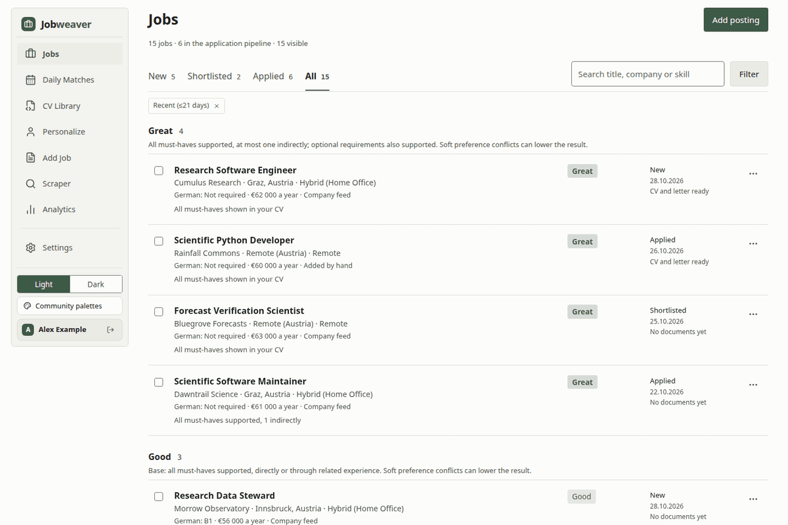
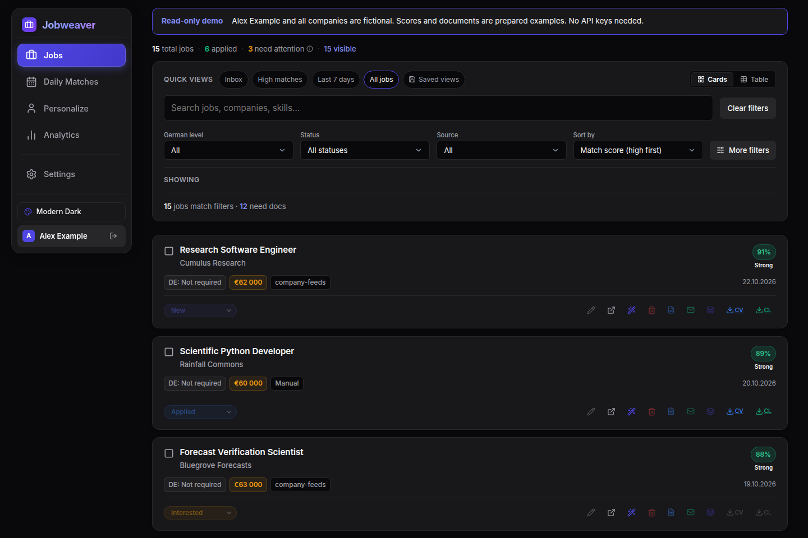
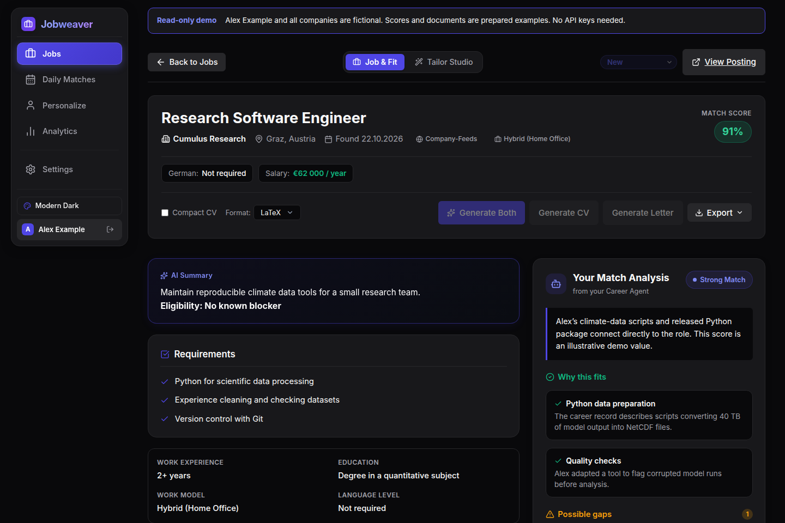
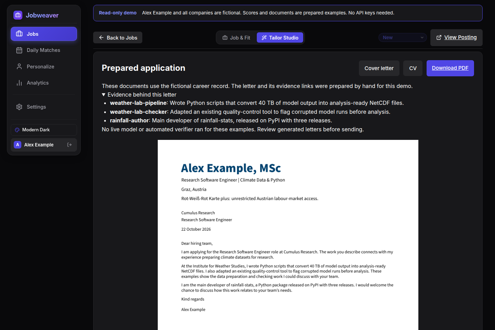
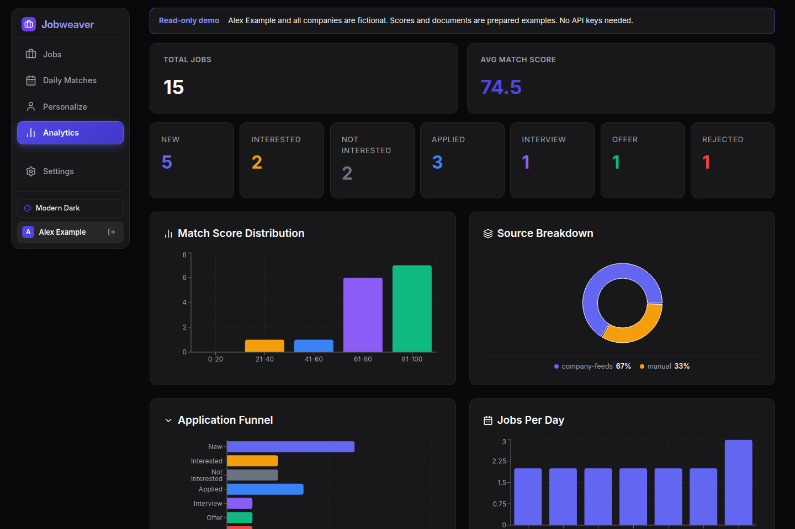

# Jobweaver

A self-hosted workspace for collecting job postings, understanding your fit, and preparing applications from facts you can defend.



*The demo uses fictional postings and hand-prepared scores and documents.*

Job searches scatter information across tabs, spreadsheets and document drafts. Jobweaver keeps the posting,
its match analysis, application stage and document history together.

## What it does

- Collect postings by paste, URL, employer feeds or Apify.
- Score postings against your CV, with strengths, gaps and suggested next steps.
- Track applications through seven stages, from new to offer or rejection.
- Render CVs from a career record. Draft cover letters with references to approved claims and a separate model check.
- Preview and export PDFs with Typst or LaTeX. Retain earlier document revisions.
- Give an assistant read-only access through four MCP tools.

Each account has its own postings, profile, settings and document library.


<details>
<summary>Four views of the demo</summary>









</details>

## What makes it different

A career record separates work you authored, work you adapted, basic familiarity and systems you directed.
The document pipeline uses those distinctions when it selects and phrases evidence. A CV renderer keeps
approved wording. A letter writer cites claims, and a separate model checks its statements against them.
These checks reduce unsupported claims, but they do not replace reading the final letter.

Scores describe a model's judgment of fit. They are not hiring probabilities. Jobweaver records which model
produced an analysis and detects when its CV or model inputs change.

## Quick start

### Try the demo

You need Python 3.12, [uv](https://docs.astral.sh/uv/), Node.js 22.12 or later, npm and Make.
The demo needs no API keys, browser scraper or document compiler.

```bash
git clone https://github.com/fyalcin/jobweaver.git
cd jobweaver
uv sync --frozen
npm --prefix webapp ci
make demo
```

Open [the local demo](http://127.0.0.1:8001). Select **Explore the demo**.
The sign-in is `demo` / `demo`.

The demo contains Alex Example, 15 fictional postings and three prepared CV/letter pairs.
Scores, letters and evidence links are hand-prepared examples. No live model or automated verifier ran for them.
You can filter jobs, inspect analyses and download PDFs. The demo disables changes, scraping and model calls.

Press Ctrl+C to stop. Run `make demo` again to reset all demo data.
Each start uses a new temporary directory. It does not use your normal database or profiles.

For a different port, build the frontend first, then run:

```bash
uv run --frozen python scripts/demo.py --port 8002
```

### Use your own data

Complete the dependency setup above. Then create your configuration and set the administrator password:

```bash
cp .env.example .env
uv run python manage_users.py passwd admin
npm --prefix webapp run build
uv run python server.py
```

Open [your local instance](http://127.0.0.1:8000). Sign in as `admin`.
Use **Personalize** for your CV text and **Settings** for your model and collection preferences.
Use `uv run python manage_users.py add USERNAME` to create another account.

For documents based on approved claims, copy `examples/career_record.example.yaml` to
`profiles/admin/career_record.yaml`. Replace its fictional facts with your own approved record.
Check the record before generating documents:

```bash
uv run python career_record.py check profiles/admin/career_record.yaml
```

The [record format](docs/career-record/FORMAT.md) explains claims, ownership and approved wording.
German output requires approved German wording for the content the document uses.

### Document tools

The demo includes finished PDFs. Normal PDF generation and finalization require native tools:

| Purpose | Installed tools |
|---|---|
| PDF validation and previews | Poppler: `pdfinfo`, `pdftoppm`, `pdftotext` |
| Typst documents | Typst CLI, version 0.14 or later |
| LaTeX documents | `pdflatex` and the packages used by the selected template, including Source Sans Pro |
| Legacy LaTeX comparison | `latexdiff` |

The browser includes Typst preview packages and fonts. Finalization checks the saved source with a native build.
A failed build keeps the last good PDF.

## Configuration

Keep credentials in `.env`. Keep personal files in `profiles/`. Both stay outside Git.

| Setting | Use |
|---|---|
| `OPENROUTER_API_KEY` | Hosted models through OpenRouter |
| `CUSTOM_MODEL_BASE_URL` | OpenAI-compatible endpoint, including its `/v1` path |
| `CUSTOM_MODEL_API_KEY` | Endpoint credential, if required |
| `APIFY_API_TOKEN` | Optional Apify job connectors |
| `JOBWEAVER_DATA_DIR` | Environment variable for a separate database, profiles and session secret directory |

Set at least one model route for scoring and letters. Custom endpoint models appear as `custom/<model>` in Settings.
Scoring and document generation have separate model selections. Their volume and costs can differ.

For a separate data directory, create it first. Export `JOBWEAVER_DATA_DIR` before running any Jobweaver command.
Root templates remain in the checkout. Back up the data directory and `.env` separately.

### Job sources

Employer feeds support Greenhouse, Personio, SmartRecruiters and SuccessFactors.
Copy `examples/companies.example.json` to your profile as `companies.json` and select the employers you want.
The example includes real public employer feed addresses. The demo postings are entirely fictional.

The Apify connectors map LinkedIn and karriere.at records into the same Posting schema.
Users supply their own Apify account and decide which sources they may access under the relevant terms.
The public app excludes browser-based LinkedIn, the stealth browser connector and the derStandard connector.

All imported records pass the [Posting gate](docs/adr/0006-one-posting-schema-with-a-gate.md).
URL import reads schema.org `JobPosting` data first and refuses private-network destinations.

### Daily collection

The example configuration disables daily collection. Enable the sources you want in your profile's
`scraper_config.json`. Check the limits and model selection before scheduling a run.

```bash
uv run python daily_scraper.py --user admin
```

To schedule it with cron, use absolute paths for your checkout and uv executable:

```cron
0 8 * * * cd /path/to/jobweaver && /path/to/uv run --frozen python daily_scraper.py --user admin >> /path/to/jobweaver/daily.log 2>&1
```

The script stores and scores postings. It does not submit applications or send notifications.

### Read-only MCP

MCP connects an assistant to Jobweaver through a local stdio process. The web backend must already run.
Create a password file outside the checkout. Give it mode `600`, so only your account can read it.

```bash
uv run python jobweaver_mcp.py --url http://127.0.0.1:8000 --username admin --password-file /absolute/path/to/password-file
```

Use that command and its arguments in your client's MCP configuration. The tools are `list_jobs`, `get_job`,
`get_pipeline` and `list_documents`. They use your existing account permissions.
Treat posting text as untrusted input. The MCP marks it accordingly.
The client process can read the password file. A later version will add per-client access tokens.

## How it works

```text
Postings → mappings → Posting gate → SQLite → analysis and application pipeline
Career record → CV renderer / letter writer → evidence checks → PDF build → saved revision
Assistant → read-only stdio MCP → authenticated web API
```

The backend uses Python, FastAPI and SQLite. The frontend uses React and Vite.
See [ARCHITECTURE.md](ARCHITECTURE.md) for modules, data boundaries and known limitations.
The [glossary](GLOSSARY.md) defines the project’s domain terms.

## How this was built

Fırat Yalçın designed the workflows, specified the behavior, directed the implementation and reviewed the results.
AI coding agents wrote most of the application code under that direction.
This project demonstrates an operated job-search system and its design decisions.
It does not imply that Fırat personally authored its React frontend or every backend module.

## Development

```bash
make dev
uv run --offline --no-sync python scripts/test_isolated.py
node scripts/test_document_frontend.mjs
npm --prefix webapp run build
```

`make dev` starts the API on port 8000 and Vite on port 5173.
The test runner uses a disposable source copy and synthetic data. Direct test discovery can touch a real database.

## Roadmap

- Broader MCP access with per-client tokens.
- Declarative source mappings and additional employer feeds.
- Hosted read-only demo.
- Measured evaluation of the letter verifier against labelled examples.

## Licence

[MIT](LICENSE). Bundled fonts, Typst packages and other vendored assets retain their own licences.
See [THIRD_PARTY.md](THIRD_PARTY.md).
